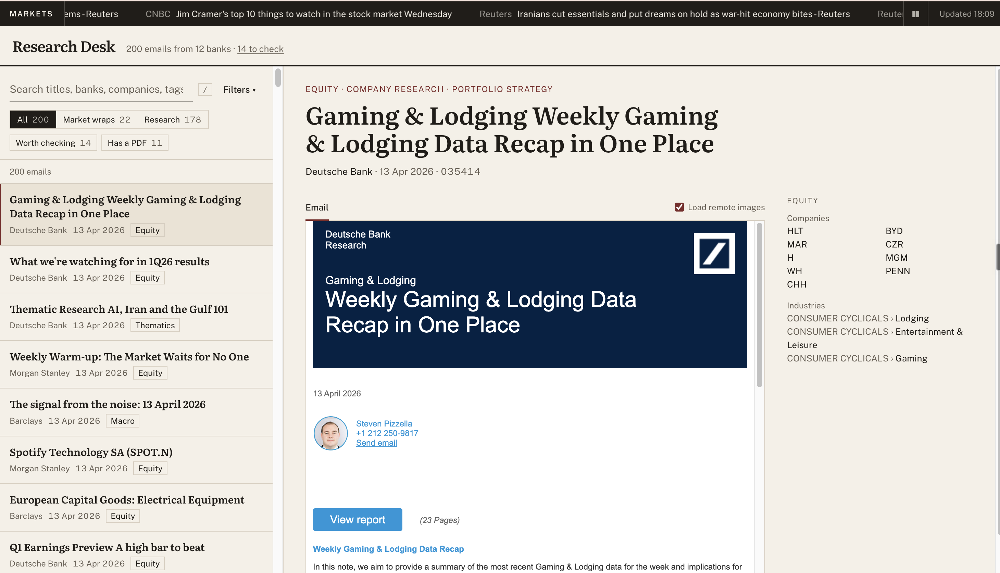
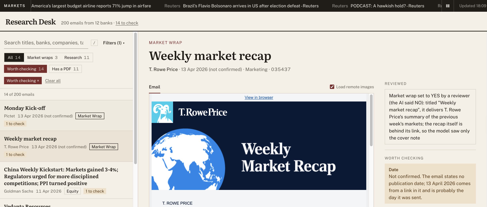

# Research email classifier

Banks send their clients research by email: morning recaps, notes on a company, views on
currencies or rates. This project reads 200 of those emails and works out, for each one, which
bank sent it, when, what it covers, and whether it is a market wrap (a recap of what the markets
did). The results are in `classified_emails.json`, and a small website lets you search them and
read each email next to its answers.

All 200 emails are classified. I labelled 20 of them by hand: bank, market wrap and main asset
class match on all 20, and the date on 18 (the two misses are emails where I chose to leave an
uncertain date empty).



## Running it

You need [Git](https://git-scm.com) and the email archive that came with the brief
(`Data.zip`). The emails are licensed, so they are not in this repository.

The classified results are already committed, so you can open the dashboard without an AI
model or any key. You only need a key to classify the emails again or to use the Ask tab.

### With Docker

You need [Docker Desktop](https://www.docker.com/products/docker-desktop/) running.

1. Clone the repository:

   ```bash
   git clone https://github.com/abdelmalek-maskri/compu-J.git
   cd compu-J
   ```

2. Put `Data.zip` in that folder and unzip it. You should end up with `Data/035239/emailbody.html`
   and 199 more folders like it.

   ```bash
   unzip Data.zip
   ```

3. Optional: copy `.env.example` to `.env` and add a free [Finnhub](https://finnhub.io) key for
   the headlines. Without one, CNBC's public feed is used.

4. Build and start:

   ```bash
   docker compose up --build
   ```

5. Open <http://localhost:8000>.

`Ctrl+C` stops it, `docker compose down` removes the containers.

The Ask tab needs `OPENAI_API_KEY` in `.env` and a search index in `output/rag/`. An index
built without Docker is used as it is; to build one inside Docker instead, while it runs:

```bash
docker compose run --rm dashboard python -m rag.captions   # optional: describe the pictures
docker compose run --rm dashboard python -m rag.ingest
```

To classify the emails again, run it without Docker.

### Without Docker

You need [uv](https://docs.astral.sh/uv/getting-started/installation/) (it installs Python 3.11
and the Python packages for you) and [Node 22](https://nodejs.org).

1. Clone the repository and unzip the emails, as in steps 1 and 2 above.

2. Install the dependencies and create `.env`:

   ```bash
   uv sync                  # Python packages, into .venv
   cd web && npm ci && cd ..  # dashboard packages
   cp .env.example .env
   ```

3. Start the server, the headline fetcher and the dashboard, each in its own terminal:

   ```bash
   uv run uvicorn api.main:app --reload       # the API, on port 8000
   uv run python fetch_news.py --every 10     # headlines now, then every 10 minutes
   cd web && npm run dev                      # the dashboard
   ```

4. Open <http://localhost:5173>.

If you have `make`, `make setup` does step 2 and `make dev` runs the three commands of step 3 in
one terminal (`Ctrl+C` stops all of them). `make` on its own lists every command.

### Classifying the emails again

Add a free [Gemini key](https://aistudio.google.com) to `.env` as `GEMINI_API_KEY`, then:

```bash
uv run python classify.py
```

AI answers are saved, so a second run only asks about emails that changed. To run a model on
your own machine instead, install [Ollama](https://ollama.com) and set `LLM_MODEL=gemma` in
`.env` (it needs about 15 GB of memory).

### The Ask tab

The Ask tab answers questions from the emails and their PDFs. It needs a search index, built
once. The default embeds the passages with OpenAI (add `OPENAI_API_KEY` to `.env`, about a
cent for all of them):

```bash
uv run python -m rag.captions                   # optional: describe the charts, tables and cartoons
uv run python -m rag.ingest                     # OpenAI embeddings
uv run python -m rag.ingest --embedder ollama   # local and free: ollama pull embeddinggemma first
uv run python -m rag.ingest --no-embed          # keyword search only, no model at all
```

Answering a question and describing pictures use the model set in `RAG_MODEL` (default
`gpt-6-luna`), separate from the classifier's `LLM_MODEL`.

To measure it on 29 questions whose sources are known:

```bash
uv run python -m rag.evaluate                   # does the search find the right email or page?
uv run python -m rag.evaluate_answers           # answer them, then label each point by hand
uv run python -m rag.evaluate_answers --score   # how many points their quotes really support
```

## Settings

All settings live in `.env`. None is needed to browse the results.

| Setting | What it does |
| --- | --- |
| `LLM_MODEL` | the model that classifies: `gemini-flash-lite` (default, used for the submitted results), `gemini-flash`, or a local `gemma` or `gpt-oss-20b` through Ollama |
| `GEMINI_API_KEY` | key for the Gemini models, free from [Google AI Studio](https://aistudio.google.com) |
| `OPENAI_API_KEY` | key for the Ask tab's default embeddings and answers |
| `RAG_MODEL` | the model that answers in the Ask tab and describes pictures: `gpt-6-luna` (default) or any preset above |
| `FINNHUB_API_KEY` | key for the headlines, free from [Finnhub](https://finnhub.io); without it, CNBC's public feed is used |
| `OLLAMA_API_BASE`, `OLLAMA_NUM_CTX` | local models only: where Ollama runs and how much text it reads at once |

## Tests

```bash
uv run pytest            # 358 Python tests
cd web && npm test       # 31 dashboard tests
```

They use made up emails and a fake model, so they need neither a key nor the data, and they run
on every pull request. To score the results against the hand labels:

```bash
uv run python -m scripts.accuracy --score
```

## How it works

```text
Data/ (emails) ──► classify.py ──► classified_emails.json ──► api/ (server) ──► web/ (dashboard)
                      ▲                                          ▲
                   AI model                       fetch_news.py ─┘ (headlines)
```

Each email goes through five steps:

1. Its HTML is turned into plain text, along with the first pages of its PDFs.
2. An AI model answers every field. Separately, plain Python rules look for the bank and the
   date.
3. The AI's answer is kept only when the email backs it up: the bank has to be named in it, the
   date quoted from it, the title copied from it. Where the two disagree, the email gets a flag
   with the reason, and the dashboard lists it under "worth checking".
4. The brief's rules are applied, for example a market wrap lists no companies.
5. Corrections a person made to flagged answers (`evaluation/reviewed.csv`) are applied.

The dashboard never calls the AI model. It reads `classified_emails.json`, shows each email
with its scripts removed and its tracking images blocked, and lets you filter by market wrap,
date, bank and asset class.



A few choices worth knowing about:

* When the date is uncertain, it is left empty rather than guessed.
* When the AI made the same mistake repeatedly, I fixed it in code rather than adding to the
  prompt, because changing the prompt also moved answers it already had right.
* A person only corrects what the system flagged, so the results stay the system's own work.

The Ask tab splits the emails and PDFs into passages of about 400 tokens, narrows them by the
classification's bank, date and tags, and then combines keyword search with embedding search.
The model has to quote its source for each point, and Python checks that the quote really is in
that passage. Pictures (charts, tables, cartoons) are described once by a vision model and
searched like text; a chart's figures are read twice, and only those both reads agree on, or
that the text around the picture states, are kept. A question that names a kind of picture ("any funny
cartoons?") searches those pictures first, and says so; one that compares banks ("Barclays
and Goldman Sachs", or "all the banks") searches each bank on its own.

## Limitations

* 20 known mistakes remain in 18 emails, mostly titles and asset tags. None of them was
  flagged, so none was corrected by hand. They are
  [listed with their causes](evaluation/how-the-results-were-checked.md#known-mistakes-in-the-submitted-file).
* Asking the AI again can change a few answers; saved answers keep each run repeatable.
* The classifier reads text only, so a title that appears only in an image is missed.
* The Ask tab describes pictures stored as images; a chart drawn as vector graphics in a PDF is
  found only through its text labels.
* This is not built for production: there is no login, results are files rather than a
  database, and the Gemini free tier limits how many emails can be classified a day.

## More detail

* [How it works](docs/how-it-works.md): each step, the brief's rules, how dates are decided
* [Architecture](docs/architecture.md): the parts, where data lives, the API, safety
* [Findings](docs/findings.md): what I found in the data and what I did about it
* [How the results were checked](evaluation/how-the-results-were-checked.md): the review,
  accuracy and known mistakes
* [Accuracy report](evaluation/accuracy.md): the latest score against the hand labels
