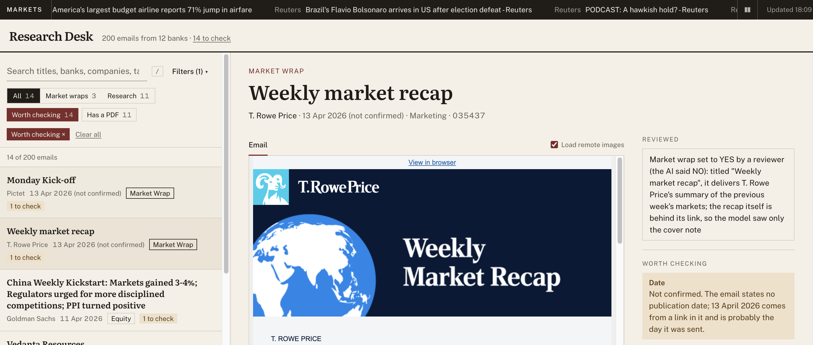

# Research email classifier

Investment banks send their clients research by email: daily market recaps, notes on a
company, views on currencies or interest rates. This project reads 200 of those emails and,
for each one, works out who sent it, when, what it is about, and whether it is a "market wrap"
(a recap of what the markets did). The answers go to `classified_emails.json`, and a small
website lets you search them and read each email next to its answers.

**Result:** all 200 emails classified. On 20 independently labelled emails, the bank, the
market wrap decision and the main asset class are 20 of 20 right, and the date 18 of 20 (both
misses are deliberate choices about uncertain dates).

## What it looks like


**Filters:** market wraps or research first, then date, bank and asset class, each with a
count.


**Worth checking:** the emails marked for a person, one of them open, with a decision under
"Reviewed" and the reason its date is not confirmed.



## Features

* **Classifies every email** into the brief's ten fields: title, bank, date, market wrap,
  main asset class, all asset classes, companies, industries, PDFs and folder number.
* **Checks the AI's answers in code.** The bank must be named in the email, the date must be
  quoted from it, and the title is copied from it. Anything doubtful is marked "worth
  checking", with the reason in plain words.
* **A review step.** A person settles the answers code cannot, in a file every run applies.
* **A dashboard** to search and filter the emails (market wraps, date, bank, asset class),
  read each one safely, and open its PDFs.
* **A strip of live market headlines**, refreshed every 10 minutes.

## Quick start

With [Docker](https://www.docker.com/products/docker-desktop/): copy the email folders into
`Data/`, then run the line below and open <http://localhost:8000>. It shows the results already
in this repository, so no AI model or key is needed.

```bash
docker compose up --build
```

Without Docker, you need [uv](https://docs.astral.sh/uv/) and [Node 22](https://nodejs.org):

```bash
make setup        # install everything
make dev          # the server, the headlines and the dashboard: open http://localhost:5173
make classify     # classify the emails again (needs a key, see Configuration)
```

`make` alone lists every command, and [the step by step version](docs/how-it-works.md#run-it-step-by-step)
shows what each one runs.

## Architecture

```text
Data/ (emails) ──► classify.py ──► classified_emails.json ──► api/ (server) ──► web/ (dashboard)
                      ▲                                          ▲
                   AI model                       fetch_news.py ─┘ (headlines)
```

The AI model is only used by the classifier; browsing the results never calls it. More in
[docs/architecture.md](docs/architecture.md), including the server's API.

## How it works

1. **Clean.** Each email's HTML becomes plain text, with the first pages of its PDFs.
2. **Read twice.** An AI model answers every field; ordinary Python rules look for the bank
   and the date on their own.
3. **Check.** An answer from the AI is kept only when the email confirms it. Every
   disagreement is written down as a flag, in plain words.
4. **Apply the brief's rules**, for example: a market wrap lists no companies.
5. **Apply a person's decisions** on flagged answers, then write the results.

The details, including how dates are decided, are in
[docs/how-it-works.md](docs/how-it-works.md).

## Configuration

Copy `.env.example` to `.env`. Only classifying needs a key; the dashboard does not.

| Setting | What it is for |
| --- | --- |
| `LLM_MODEL` | which AI model classifies: `gemini-flash-lite` (the default, and the one used for the submitted results), `gemini-flash`, or a local one through Ollama, `gemma` or `gpt-oss-20b` |
| `GEMINI_API_KEY` | a free key from [Google AI Studio](https://aistudio.google.com), for the Gemini models |
| `FINNHUB_API_KEY` | a free key from [Finnhub](https://finnhub.io) for the headlines; without it, CNBC's public feed is used |
| `OLLAMA_API_BASE`, `OLLAMA_NUM_CTX` | local models only: where Ollama runs, and how much text it reads at once |

The emails (`Data/`) are licensed research, so they are not in this repository. AI answers
are saved, so classifying again only asks about emails that changed.

## Testing

```bash
make test                                   # 232 Python tests and 17 dashboard tests
uv run python -m scripts.accuracy --score   # score the results against the hand labels
```

The tests use made up emails and a fake AI model, so they need no key and no data. They run on
every pull request. How the results were checked, by hand and against labels, is in
[evaluation/how-the-results-were-checked.md](evaluation/how-the-results-were-checked.md).

## Design decisions

* **The AI decides meaning; Python checks facts.** Both answers are kept, and every
  disagreement becomes a flag. ([How each email is read](docs/how-it-works.md#how-each-email-is-read))
* **An uncertain date is left empty, never guessed.** ([How dates are decided](docs/how-it-works.md#how-dates-are-decided))
* **Repeated mistakes are fixed in code, not with more instructions to the AI**, because
  asking the AI again also moves answers it got right. ([How the results were checked](evaluation/how-the-results-were-checked.md))
* **A person settles only what the system flags**, so the results stay the system's own work.
  ([Known mistakes](evaluation/how-the-results-were-checked.md#known-mistakes-in-the-submitted-file))
* **Emails are shown safely**: scripts removed, and the banks' tracking images blocked unless
  asked for. ([Safety](docs/architecture.md#safety))

Everything I found in the data, and what I did about each, is in
[docs/findings.md](docs/findings.md).

## Limitations

* **20 known mistakes remain in 18 emails**, mostly in titles and asset tags. None is flagged,
  so none was corrected by hand. They are [listed with their causes](evaluation/how-the-results-were-checked.md#known-mistakes-in-the-submitted-file).
* **The figures are optimistic.** The same 200 emails were used to improve the system and to
  measure it.
* **Asking the AI again moves a few answers.** Saved answers keep each run repeatable.
* **Not built for production:** no login, files instead of a database, one computer, and the
  free tier of the AI model limits how many emails it reads a day.
* **The AI reads text only**, so a title shown only in an image is missed.

## Documentation

| Page | What it covers |
| --- | --- |
| [How it works](docs/how-it-works.md) | the steps, how each email is read, the brief's rules, how dates are decided |
| [Architecture](docs/architecture.md) | the parts, where data lives, the server's API, safety, where things are |
| [Findings and decisions](docs/findings.md) | what I found in the data, and what I did about each |
| [How the results were checked](evaluation/how-the-results-were-checked.md) | the full review of the results, accuracy, and the known mistakes |
| [Accuracy report](evaluation/accuracy.md) | the latest score against the hand labels |
