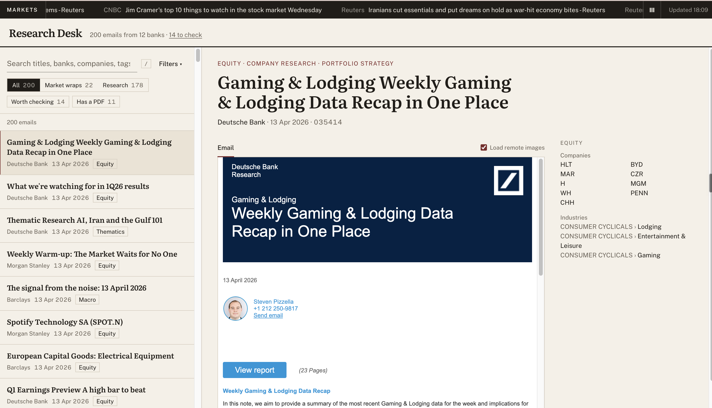
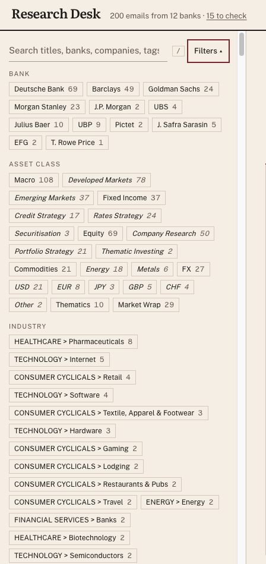
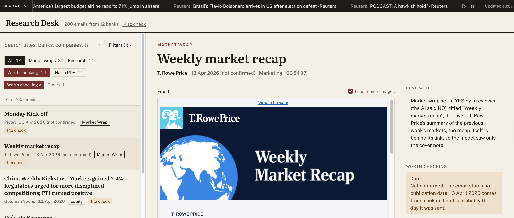

# Research email classifier

Investment banks send their clients research by email: daily market recaps, notes on a
company, views on currencies or interest rates. This project takes 200 of those emails and,
for each one, works out who sent it, when, what it is about, and whether it is a "market
wrap" (a recap of what the markets did). It writes the answers to `classified_emails.json`,
and a small website (the dashboard) lets you search the results and read each email next to
its answers, under a strip of live market headlines.

## What you get

* **`classified_emails.json`**: one entry per email with the ten fields the brief asks for:
  title, bank, date, market wrap (YES or NO), main asset class, all asset classes, companies
  and industries (for company research only), PDF attachments, and the email's folder number.
* **`classified_emails_details.json`**: for each email, where every answer came from, so any
  value can be traced back to the email.
* **The dashboard**: search and filter the 200 emails, read each one safely, open its PDFs, and
  see which emails are worth a second look and why.

**Result:** all 200 emails classified, none failed. 14 emails are marked "worth checking",
each with the reason in plain words, and 4 more flagged answers were settled by a person. On
20 independently labelled emails, the bank, the market wrap decision and the main asset class
are 20 of 20 right, and the date 18 of 20 (both misses are deliberate choices about uncertain
dates). How I checked and improved the results
is described step by step in
[evaluation/how-the-results-were-checked.md](evaluation/how-the-results-were-checked.md).

## What it looks like



**Search and filters.** Market wraps or research first, then date, bank and asset class, each
with a count of the emails it would show.



**Why an email is worth checking.** The list filtered to the emails worth checking, with one
of them open: a person's decision under "Reviewed", and why its date is not confirmed.



## How each email is read

Every email is read twice, by two readers that work in different ways:

* **The model**: an AI language model (an LLM) that reads the whole email, like a person
  would. It answers every field. It understands meaning, but it can be wrong with confidence.
* **The rules**: ordinary Python code, no AI. They look for the bank's name in the logo or the
  signature, and for a date near the top of the email or in a PDF's file name. They cannot
  understand meaning, but they never invent anything.

The model's answer is used when the email confirms it: the bank it names must appear in the
email, the date it gives must be quoted from the email, and its title is copied from the
email's own line. Otherwise the rules' bank is used; the date works differently (see
[How dates are decided](#how-dates-are-decided)). When something is uncertain, nothing is
decided silently: the email is marked "worth checking", with the reason in plain words, for
example *"The email mentions 15 April 2026, after the day it arrived, so it is probably an
event or a deadline, not the day it was published."*

A third reader is a person, who only looks at flagged answers that code cannot settle. Each
decision is one line in `evaluation/reviewed.csv`, with the reason, and every run applies
them, so a decision is never lost. The dashboard shows them under "Reviewed", next to what the
AI had said. Four answers were settled this way; mistakes that nothing flags are listed, not
corrected by hand (see
[evaluation/how-the-results-were-checked.md](evaluation/how-the-results-were-checked.md)).

## What the rules fix on their own

The brief sets some answers by rule, whatever the AI says. Python applies those rules after
the AI answers (`pipeline/tag_rules.py`), and writes down every change it makes in the email's
`corrections` list in `classified_emails_details.json`. These are not shown as "worth
checking": the brief decides them, so there is nothing for a person to judge.

| Rule from the brief | Changes on the 200 emails |
| --- | --- |
| A sub-tag brings its asset class: "Emerging Markets" means "Macro" too | 21: Macro 9, FX 5, Commodities 4, Fixed Income 2, Equity 1 |
| Companies and industries are listed only for Equity (research on shares) | 2, for example `035328`, research on a company's bonds |
| A market wrap has the main asset class "Market Wrap", that tag only, and no companies | applied to all 22 market wraps, without a note |
| An email that is not a market wrap cannot carry the "Market Wrap" tag | 1, on an email a person settled as not a market wrap |

To list them all:

```bash
python3 -c "import json; [print(i, c) for i, m in json.load(open('classified_emails_details.json')).items() for c in m['corrections']]"
```

## How dates are decided

The brief asks for the publication date. Most dates in a research email are something else,
so a date is only used when the email confirms it, and an uncertain date is left empty rather
than guessed:

| What the email shows | What is used | What the reader sees | Example |
| --- | --- | --- | --- |
| A date the model quotes from the email, within a month before the email arrived and a day after | that date, read from the quote by Python, so "02.04.2026" is always 2 April | the date | 180 of 200 emails |
| A weekday with no year, such as "Monday, 13 April" | that date: the weekday fits only one year | the date | `035427` |
| The model's date is confirmed, but the rules found another one higher up | the model's date | the date, no note: the email states it, so there is nothing to check | `035334`: "Published 10 Apr, 2026" |
| A date after the email arrived | nothing | "probably an event or a deadline" | `035341` |
| A date only the rules found, which the model rejected | nothing | the date it mentions, and why it is not used | `035255`: an article in a "you might have missed" box |
| A date that follows "as of" or "as at" | nothing: it is the day figures refer to | why it is not used | `035274`: "report as of 31.03.2026" |
| A date the model quoted that is not in the email as written | nothing | why it is not used | `035356`: "as at9 April 2026" |
| No date in the text, but one in a link address (a campaign code like `_20260413`) | the link's date | the date, marked **not confirmed** | `035330`, `035429`, `035437` |
| No date at all | nothing | "No publication date found", and the day it arrived when known | `035243` |

Why not use the day the email arrived instead? It is only known for 66 of the 200 emails (it
comes from the times on attached files), and where both are known it matches the publication
day in only 33 of 56. It is shown beside an empty date as a clue, never as the date.

The rules' date is never used on its own: every time the rules found a date the model
rejected, it was another kind of date (an article listed inside the email, a date in the
attachments' names). The rules still check the model, and when both find the same date it is used even if
the model's quote is incomplete.

What this gives on the 200 emails:

| Outcome | Emails | Which |
| --- | --- | --- |
| Date confirmed by the email | 180 | |
| Date confirmed by its weekday | 3 | `035335`, `035427`, `035428` |
| Date from a link, marked not confirmed | 3 | `035330`, `035429`, `035437` |
| Empty: a date only the rules found | 3 | `035255` (an article in a "you might have missed" box), `035348` (attachment names), `035431` (each note in a digest has its own date) |
| Empty: an "as of" date | 3 | `035258`, `035278` ("Levels as of"), `035274` ("report as of") |
| Empty: a date after the email arrived | 1 | `035341` |
| Empty: a date not in the email as written | 1 | `035356` |
| Empty: no date at all | 6 | `035243`, `035279`, `035327`, `035358`, `035359`, `035375` |

Every email in the empty rows and the link row is marked "worth checking" with its reason,
except the six with no date at all: there is nothing to check, so they only say "No
publication date found".

## Run it

**The quickest way, with [Docker](https://www.docker.com/products/docker-desktop/):** copy the
email folders into `Data/`, optionally copy `.env.example` to `.env` and add a free
[Finnhub key](https://finnhub.io) for the headlines (without one, CNBC's public feed is used),
then:

```bash
docker compose up --build          # then open http://localhost:8000
```

This starts the dashboard and the headline fetcher, which refreshes every 10 minutes. It shows
the results already in this repository; nothing is sent to an AI model. The emails are read
from `Data/` but never copied into the image, and neither is `.env`.

**Without Docker, or to classify the emails again**, you need three things installed:
[uv](https://docs.astral.sh/uv/) (it sets up Python 3.11 and the project's packages),
[Node 22](https://nodejs.org) (for the dashboard), and the email folders, copied into `Data/`.
The emails are licensed research, so they are not in this repository.

```bash
uv sync                            # install the Python packages
cp .env.example .env               # then fill in the two keys below
uv run python classify.py          # classify every email, writes classified_emails.json
```

`.env` needs a free [Gemini key](https://aistudio.google.com) for the model and a free
[Finnhub key](https://finnhub.io) for the headlines. To run the model on your own machine
instead, install [Ollama](https://ollama.com) and set `LLM_MODEL=gemma` (it needs about 15 GB
of memory). Answers are saved, so running `classify.py` again costs nothing.

Then start the dashboard, in three terminals:

```bash
uv run uvicorn api.main:app --reload       # the server the dashboard reads from (port 8000)
uv run python fetch_news.py --every 10     # fetches headlines now, then every 10 minutes
cd web && npm ci && npm run dev            # the dashboard: open http://localhost:5173
```

**With `make`** (macOS and Linux have it), the same steps have short names: `make setup`,
`make classify`, `make dev` (the three above in one terminal; Ctrl+C stops them),
`make docker` and `make test`. `make` alone lists them all.

Tests use made up emails and a fake model, so they need no key and no data:
`uv run pytest` (231 tests) and `cd web && npm test` (12 tests). They run on every pull request.

## How it works

```text
Data/<folder>/        the email (HTML), its PDFs, its images
   │
   ▼  clean_emails.py       turn the HTML into plain text, read the PDFs' first pages,
   │                        and let the rules find the bank and date
   ▼  the model             one answer per email, in a fixed shape: only the brief's
   │                        tag names are accepted
   ▼  tag_rules.py          the brief's rules, for example: a market wrap gets no companies
   ▼  check_metadata.py     keep the model's bank, date and title only if the email confirms them
   ▼  flags.py              note every disagreement, in plain words
   ▼  reviewed.csv          flagged answers a person settled, applied on every run
   │
classified_emails.json + classified_emails_details.json
   │
   ▼  api/                  a small server that reads those files and the emails
   ▼  web/                  the dashboard (React)
```

## What I found in the data, and what I did about it

I read through the emails before writing any rules. Most of the design comes from what turned
up:

1. **The emails have no subject, sender or date lines.** The brief says the folder name is the
   subject, but the folders are just numbers (`035239`). So the title, bank and date all have
   to be read from the body. The title goes in `folder_name`, the number in `source_file`.
2. **The first bank named is often not the sender.** A UBP email says "issued by Goldman
   Sachs"; a J. Safra Sarasin email quotes Barclays. So the rules look where the sender
   really appears (the logo, then the signature) instead of taking the first bank they see.
3. **Most dates in an email are not when it was published.** Subscription deadlines, webinar
   times, "data as of" dates, old dates on charts. I found that the times on each email's
   attached files show when it arrived, so a date is only accepted if it falls between a month
   before and a day after that. Uncertain dates are left empty, with the reason (see
   [How dates are decided](#how-dates-are-decided)).
4. **The AI retypes titles.** It turned `’` into `'`, dropped lost characters ("isnt") or
   guessed them, so its title did not match the email letter for letter. Titles are now
   compared word by word, and when the AI's title matches a line of the email, the email's
   own line is used.
5. **Local AI models were silently reading only part of each email.** Ollama reads 4,096
   tokens unless told otherwise; the longest email is about 24,700. I set it to 32,768 and
   wrote a test that proves the whole email is read.
6. **1,563 characters were lost when the emails were exported.** In 119 emails, apostrophes,
   quotes, accents and currency signs became `�`. The real character is gone from the file,
   so I worked each one out from its context: `KO�s` is `KO’s`, `Z�rich` is `Zürich`, and
   Whitbread's `c�800m` is `c£800m` because Whitbread reports in pounds. Every rule was checked
   against every place it applies. Only what people read is repaired; the files and what the
   AI reads are untouched.
7. **138 files say they use an old text encoding, but do not.** Browsers believed the label
   and garbled the accents, so the server ignores it and states the real one (UTF-8).
8. **Every email contains a hidden script, and many contain tracking images** that tell the
   bank who opened the email and when. The dashboard shows emails with scripts removed,
   blocked by the browser, and inside a sealed frame; images from the banks' servers load only
   if you ask.
9. **381 images pointed at the bank's internal mail archive** instead of the copy saved next
   to the email, so every saved logo and chart showed as broken. The server now points them at
   the saved copy.
10. **One email appears twice** (`035428` is a copy of `035427`), and 32 start with a security
    warning from the company's email filter. The warning is removed before the AI reads them.
11. **The AI sometimes gives two answers that do not fit together, and the brief decides.**
    `035328` (Barclays, "Vedanta Resources") is about the company's bonds, not its shares. The
    AI named the company but did not call the email Equity (research on shares). The brief
    lists companies only for Equity research, so the names were removed. The result is right;
    the email is still marked "worth checking" so a person can see the AI disagreed with
    itself.
12. **Some emails only link to the report.** `035437` (T. Rowe Price, "Weekly market recap")
    is a short cover note with a button to the recap. The AI judged only the note and said it
    is not a market wrap, while choosing "Market Wrap" as its main asset class. That contradiction
    is flagged, and a person settled it in `evaluation/reviewed.csv`, which every run
    applies (see [How each email is read](#how-each-email-is-read)).
13. **The AI used sub-tags as labels, not topics.** It tagged a note on Tencent "Emerging
    Markets" because Tencent is Chinese, and the brief's rule then added "Macro", although
    the note says nothing about any economy. I found 34 such cases by reading every email the
    rule had changed, and rewrote the AI's instructions to say what each sub-tag means.
14. **Asking the AI again changes some answers.** A second run moved 140 answers in 96
    emails, including some the change was not about. So each change was judged on all 200
    emails, and patterns were fixed with checks in Python, which answer the same way every
    time, rather than with more instructions to the AI.
15. **Lists of research notes looked like market wraps.** A daily list of company notes ticks
    almost every box of the brief's market wrap checklist, yet it summarises research, not how
    the markets moved. I added that distinction to the AI's instructions, which fixed most of
    them, and a market wrap answer that names another main asset class is now flagged. The AI
    still calls four such emails market wraps; nothing flags them, so they are listed as known
    mistakes rather than corrected by hand.

The whole process, with the numbers at each step, is in
[evaluation/how-the-results-were-checked.md](evaluation/how-the-results-were-checked.md).

## Accuracy

20 emails, picked to cover all seven main asset classes and seven banks, were labelled
independently and compared with the results (`evaluation/labels.csv`, scored by
`uv run python -m scripts.accuracy --score`):

| Field | Right | The model alone | The rules alone |
| --- | --- | --- | --- |
| Bank | 20 of 20 | 20 of 20 | 20 of 20 |
| Date | 18 of 20 | 19 of 20 | 20 of 20 |
| Market wrap | 20 of 20 | | |
| Main asset class | 20 of 20 | | |

"The model alone" and "the rules alone" score each reader's own answer before the two are
combined; market wrap and main asset class come from the model only. One of the 20 labelled
emails, T. Rowe Price's "Weekly market recap", is among the answers a person settled
(finding 12), so without that correction market wrap and main asset class would be 19 of 20.

The two date misses follow from choices described in
[How dates are decided](#how-dates-are-decided). The Barclays digest lists notes with their
own dates, and none is stated as the digest's, so its date is left empty; the labeller took
the newest note's. The T. Rowe Price recap states no date, so it shows the date from its
links, marked not confirmed; the label says none.

The labels were made by Claude, a different AI model from the one being scored, reading each
email; the judgement calls are explained in the file. 20 emails give a rough figure, not a
precise one, which is why I also read all 200 results (see
[evaluation/how-the-results-were-checked.md](evaluation/how-the-results-were-checked.md)).


## Where things are

```text
classify.py          classify every email
fetch_news.py        fetch the headlines
pipeline/            reading, cleaning, the model, the rules, the checks, the character repair
news/                the headline sources, and keeping the last good headlines if both fail
api/                 the server for the dashboard, and the code that makes emails safe to show
web/                 the dashboard
scripts/             preview what the model reads, test a model, compare two models, accuracy
evaluation/          the hand labels, the accuracy report, flagged answers a person settled, and how
                     the results were checked
tests/               made up data only, never the licensed emails
Dockerfile, docker-compose.yml   the one command setup
```
